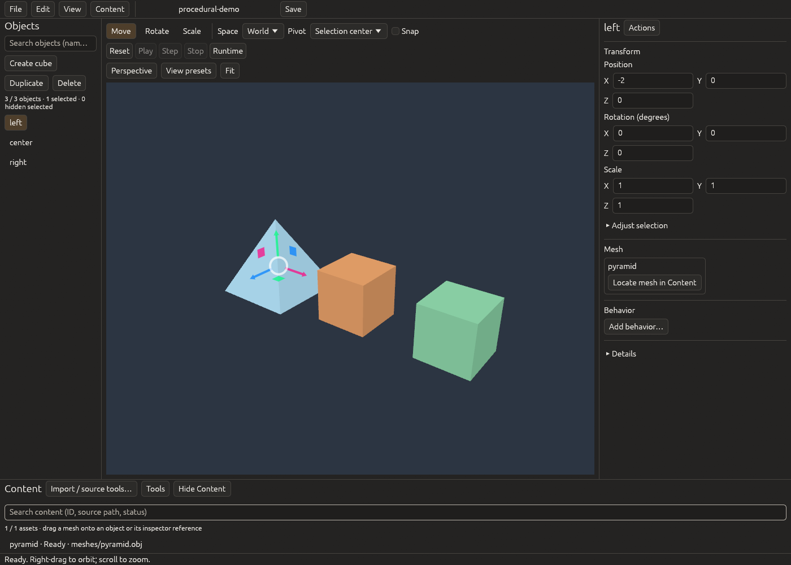

# Ruster

An open-source Rust/Vulkan engine project for interactive simulation and visualization. Games are the first proving ground; the shared scene and tooling are designed to support other interactive applications too.

Ruster's purpose is to help people turn their own ideas into working creations. Its systems and tools should serve that creative process, with understandable workflows, room to extend behavior and ownership of the result. See the [project ethos](docs/DIRECTION.md#project-ethos-serve-the-creator) and the current scope below.

[](https://github.com/akilfernando/Ruster/actions/workflows/ci.yml)
[](#license)

Familiarity for experienced Unity and Unreal creators, including everyday editor conveniences, is a core requirement. The [editor experience baseline](docs/EDITOR-EXPERIENCE.md) describes the target and the gaps still to close.

**Early development:** milestones M0–M8 provide a small, working Linux foundation. Ruster is not production-ready, and its APIs and file formats may evolve. There is no claim of feature or performance parity with mature engines. Native Vulkan/editor smoke covers NVIDIA RTX4060 Laptop and Intel Iris Xe on the recorded Linux workstation; Windows and other machines remain unverified. The Unity-experienced user confirms repaired viewport selection and live Transform feedback; broader creator-workflow acceptance remains open. The [candidate gate record](docs/ALPHA-CANDIDATE.md) tracks the interaction repairs and remaining adoption/platform limits.



## What works today

- **Shared 3D viewport:** depth-tested cubes/imported meshes, simple colored materials, perspective/orthographic and axis/isometric views, orbit/pan/fly/frame navigation, picking and bounded hardware antialiasing through wgpu's Vulkan backend.
- **Scene authoring:** create/name/duplicate/delete, multi-selection/internal copy-paste, move/rotate/scale tools, snapping/pivots/local axes, precise fields and bounded shared undo/redo. Atomic saves detect cooperating-writer conflicts.
- **Human and agent workflows:** an offline native editor and CLI, plus an optional native MCP adapter that edits the displayed session with identity/revision checks and draft protection.
- **Repeatable previews:** authored state stays separate from runtime snapshots. The scene lifecycle preview and provisional Lua behavior runtime support explicit Reset and fixed ticks; neither implies physics or gameplay simulation.
- **Content iteration:** search objects/assets, use contextual actions and drag a registered mesh onto an object. Explicit OBJ/shader refresh retains last-good content; derived binary caches and shared snapshots avoid unchanged parsing/full payload copies. Catalog/originals are authored; cache is disposable.
- **Recoverable workspace:** remappable shortcuts, remembered layout/scale/camera/recent files and bounded background checkpoints. Crash recovery retains unfinished behavior sources, typed-property drafts and invalid field/name drafts as an unsaved copy, preserving externally changed originals. Physical-focus and human-familiarity acceptance remain separate.
- **Provisional scripting workflow:** language-neutral Scene5 sources, bindings and typed properties save with the scene and share bounded undo/redo and crash recovery. The generic editor includes a bounded provisional Lua 5.4 runtime, Zed/LuaLS working-copy support, and an owned debugger with breakpoints, locals, Next and Continue. Lua is not a permanent language choice; Rust remains the native application path.
- **Independent application reuse:** the shared kit powers Yard and a non-game Motion Lab Scene5 consumer. Both can be exported, independently edited, rebuilt and packaged as Linux development artifacts. Motion Lab consumes scenes from the generic editor; it does not replace that editor's source/history workflow. The earlier Rhai Motion Lab project format remains a separate compatibility path.
- **Native MCP workflows:** an optional local MCP adapter exposes 44 bounded scene, content, behavior, runtime and debugger tools against the displayed editor session, with revision checks and draft protection.
- **A logistics reference application:** integer throughput simulation, saved scenarios, a schematic viewer and the original authoring workflow remain available separately.

The current scene limit is 256 objects and one viewport. Scene format v5 carries language-neutral behavior data; M6 adds bounded triangle-only OBJ mesh import, stable references, rebuildable caches and controlled asset/WGSL refresh. Textures/MTL, general mesh formats, physics/audio and a general ECS remain later work. M7 supplies the bounded application kit and M8 adds the shared editor/runtime/recovery workflow and independent Motion Lab consumer. See the [roadmap](docs/ROADMAP.md) and [current status](docs/STATUS.md) for exact scope and remaining acceptance gates.

## Quickstart

### Requirements

- Git and [Rust via rustup](https://rust-lang.org/tools/install/). The repository pins the tested Rust 1.99.1 toolchain, including rustfmt and Clippy.
- A working native C compiler/linker. The provisional Lua backend builds its pinned Lua5.4.9 VM from bundled source; no system Lua installation is required.
- Python 3.11 or newer for verification and application packaging.
- For graphical tools: a Linux Wayland/X11 desktop and a working Vulkan driver. A display is not required for the headless CLI or ordinary tests.

A documented [upstream SPIR-V compatibility patch](third_party/wgpu-hal/RUSTER-PATCH.md) is included with full source and licenses; newer GPU feature requirements must revisit this temporary boundary.

Native Vulkan smoke currently covers CachyOS with NVIDIA RTX4060 Laptop and Intel Iris Xe graphics. This is a named-workstation check, not a broad support matrix. The [first alpha target](docs/decisions/0025-first-alpha-platform-scope.md) is Linux x86_64. Separate [Ubuntu userspace evidence](docs/evidence/M9-ubuntu-userspace.md) covers source checks and Intel startup/resize/shutdown, sharing the same host kernel/devices; another-machine and complete Ubuntu workflow acceptance remain open. Windows remains an intended future target. Development-library package names vary by distribution; the [Linux CI workflow](.github/workflows/ci.yml) shows the Ubuntu build prerequisites.

For a supplied evaluation source archive, extract it and enter its root directory; skip the clone step below. Its paired `SOURCE-MANIFEST.json` identifies the exact candidate revision. The clone command follows the published branch, which can lag a local evaluation candidate.

```sh
git clone https://github.com/akilfernando/Ruster.git
cd Ruster
cargo run --locked -p ruster-editor -- --scene examples/arrangement.scene.json
```

Run `cargo run --locked -p ruster-editor` for a blank creation workspace. Scene sources, workspace preferences and local recovery records have separate lifetimes; see the [editor guide](crates/ruster-editor/README.md).

Select an object in the hierarchy or click a cube. Edit a Position, Rotation or Scale component, then press Enter or choose **Apply transform components**. Escape reverts a pending component edit; invalid text stays available for correction. Right-drag to orbit, scroll to zoom, and use **Fit** to frame the scene. **Edit → Undo** reverses an authored change. Use **File → Save as…** to keep experiments separate from the checked-in example.

For a first creation from the blank workspace, using the default shortcuts:

1. Choose **Create cube**, press F2, type a name and press Enter.
2. Use W/E/R for Move/Rotate/Scale. Drag a handle, or enter transform values in the inspector; Escape cancels an unfinished edit.
3. Press Ctrl+D to duplicate, then Ctrl+Z to undo. **View** lists navigation commands and their current shortcuts; **Perspective/Orthographic** and **View presets** are beside the viewport.
4. Use **File → Save as…** to save a new scene, then **File → Open scene…** to reopen it. Recovery checkpoints are under **File → Recovery checkpoints…**; restoring one creates an unsaved copy.

Open the same scene in the standalone renderer:

```sh
cargo run --locked -p ruster-render -- --scene examples/arrangement.scene.json --ticks 10
```

For a headless first run:

```sh
cargo run --locked -p ruster-scene -- run examples/arrangement.scene.json 10
```

This reports the scene identity, revision, three objects, ten preview ticks and a deterministic snapshot fingerprint. See the [editor guide](crates/ruster-editor/README.md), [scene API and CLI](crates/ruster-scene/README.md) and [renderer guide](crates/ruster-render/README.md) for editing, persistence guarantees and diagnostics.

### Build your own application

The Yard and Motion Lab examples demonstrate application-owned behavior using the shared kit. Run the Yard delivery challenge, or export either example to a new editable workspace:

```sh
cargo run --locked -p ruster-yard -- --resources examples/yard-app/resources
python3 scripts/new_app.py /tmp/my-ruster-app
python3 scripts/new_app.py --app motion-lab /tmp/my-motion-lab
```

Use Run/Pause, Step and Reset. The default truck capacity misses the delivery target; capacity 3 completes it. Change the application rules in `examples/yard-app/src/lib.rs`, rebuild and package your result. Motion Lab is a non-game consumer of the shared Scene5 runtime. Exports require the pinned dependencies in the local Cargo cache; see the [application guide](examples/yard-app/README.md), [Motion Lab guide](examples/motion-lab/README.md), [kit API](crates/ruster-app/README.md) and [distribution workflow](docs/DISTRIBUTION.md). These are Linux development artifacts, not a supported release matrix; editor/MCP services are not runtime requirements.

### Try behavior scripting

Open the generic Scene5 example in the editor, where behavior sources and their bindings/properties are authored with the scene:

```sh
cargo run --locked -p ruster-editor -- --scene examples/motion-lab/resources/generic.scene.json
cargo run --locked -p ruster-motion-lab -- --scene examples/motion-lab/resources/generic.scene.json --headless --ticks 10
```

Select an object to inspect its attached behavior. To add one, create/select an unattached object and choose **Behavior → Add behavior… → Lua follower**. Edit source or typed properties, then use **Reset** and **Play** above the viewport. Save/reopen retains behavior data with the scene; source and property edits participate in shared undo and recovery. For external editing, export or open the working copy in Zed; the editor generates LuaLS configuration and host/property types. The in-editor debugger supports source breakpoints, bounded locals, Next and Continue. Lua remains provisional, and human physical-focus/familiarity acceptance is still open. The separate legacy Rhai `project1` workflow remains available and is not silently converted to Scene5. See the [editor behavior guide](crates/ruster-editor/README.md#embedded-behavior-authoring-and-execution), [Motion Lab guide](examples/motion-lab/README.md), [behavior backend](crates/ruster-behavior/README.md) and [language decision gate](docs/decisions/0011-behavior-scripting-experiment.md).

### Imported content example

```sh
cargo run --locked -p ruster-editor -- --scene examples/content/scene.json
cargo run --locked -p ruster-render -- --scene examples/content/scene.json --shader examples/content/scene.wgsl
```

The project includes an original pyramid OBJ and stable-ID catalog. Use a disposable copy to try source edits, refresh and rename; see the [content workflow](crates/ruster-editor/README.md#mesh-content-and-shader-iteration-m6) and [asset API/CLI](crates/ruster-assets/README.md). Older supported scene files migrate on load; explicit Save writes current Scene5 data, including language-neutral behavior sources and bindings. Asset catalog operations persist independently of scene Undo/Discard.

### Optional MCP connection

MCP is opt-in and currently attaches to one local Linux editor. No AI account or MCP service is required for manual use.

```sh
cargo build --locked -p ruster-editor -p ruster-mcp
RUSTER_MCP_ENABLE=1 cargo run --locked -p ruster-editor -- --scene examples/arrangement.scene.json
```

The editor prints a private socket path to stderr. Configure a stdio MCP client to launch the absolute path to `target/debug/ruster-mcp` with that path in `RUSTER_MCP_SOCKET`. Start with `scene_inspect`; changes require the exact inspected session token and revision. Unapplied human drafts block agent edits, and agent changes share the editor's undo history.

The current adapter exposes 46 bounded tools across scene/content authoring, behavior data, runtime/debugging and explicitly granted scene persistence. The tested client is the official Python MCP SDK 2.3.0 with protocol revision 2025-06-18. The [MCP guide](crates/ruster-mcp/README.md) includes client configuration, the reproducible SDK demo and connection limits. There are no shell or arbitrary file-access tools. Scene Save/SaveAs additionally requires an explicit `RUSTER_MCP_SAVE_DIR` grant; its independent persistence token protects against a human changing the save association.

### Logistics reference

```sh
cargo run --locked -p ruster-cli -- run examples/logistics.scenario.json --ticks 10
cargo run --locked -p ruster-editor -- --scenario examples/logistics.scenario.json
cargo run --locked -p ruster-viewer -- --scenario examples/logistics.scenario.json
```

The ten-tick logistics run produces 30 items, delivers 20 and leaves 10 in stock. Logistics scenarios and generic scenes have distinct identified formats; they are not silently converted. The direct-ash schematic viewer is retained as a reference experiment; new 3D work uses the shared renderer.

## Development and verification

```sh
python3 scripts/check.py --dry-run
python3 scripts/check.py
```

For a pull request, pass `--base` with its actual target reference. Use `--full` when dependency impact is uncertain. The runner selects formatting, strict Clippy, affected-package tests, tooling tests and documentation checks. GPU lifecycle, native UI and performance evidence are separate checks required when those boundaries change; ordinary CI does not claim to validate a GPU.

Read [CONTRIBUTING.md](CONTRIBUTING.md) before opening a change. [AGENTS.md](AGENTS.md) documents the human/agent continuity workflow, and [docs/TESTING.md](docs/TESTING.md) is the single testing policy. The project is developed with AI assistance; implementation claims are backed by recorded commands and evidence, not generated-code confidence alone.

## Documentation

| Topic | Entry point |
| --- | --- |
| Current implementation, verification and limitations | [Status](docs/STATUS.md) |
| Delivery sequence and acceptance gates | [Roadmap](docs/ROADMAP.md) |
| Create, modify and package an application | [Application kit](crates/ruster-app/README.md), [distribution](docs/DISTRIBUTION.md), [M7 evidence](docs/evidence/M7.md) |
| Product direction | [Direction](docs/DIRECTION.md) |
| Architecture and tradeoffs | [Decisions](docs/decisions/README.md) |
| Scene/editor/MCP delivery evidence | [M5 evidence](docs/evidence/M5.md), [M6 content evidence](docs/evidence/M6.md), [M8 debugger](docs/evidence/M8-debugger-native.md), [M8 Motion Lab](docs/evidence/M8-motion-native.md), [M8 independent reuse](docs/evidence/M8-independent-reuse.md) |
| Performance methods and bounded measurements | [Performance](docs/PERFORMANCE.md) |
| Dependency licenses and notices | [Dependency inventory](docs/DEPENDENCIES.md) |
| Reporting a vulnerability | [Security policy](SECURITY.md) |

## License

Ruster's original source code, documentation and examples are available under either the [MIT License](LICENSE-MIT) or the [Apache License, Version 2.0](LICENSE-APACHE), at your option: `MIT OR Apache-2.0`. There is no proprietary engine component or mandatory hosted service in this repository.

Third-party dependencies retain their own licenses, including bundled font and Unicode terms. See [THIRD_PARTY_NOTICES.txt](THIRD_PARTY_NOTICES.txt) and the [locked dependency inventory](docs/DEPENDENCIES.md). Cargo packages remain marked `publish = false` while APIs mature; this limits accidental crates.io publication, not your rights under the source licenses.
