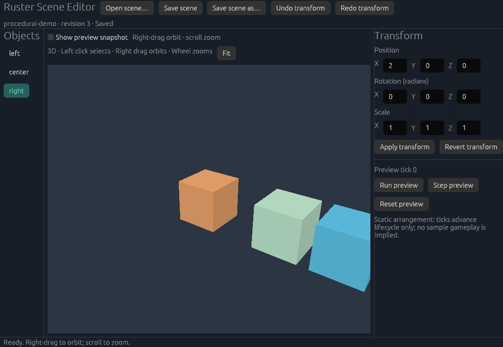

# Ruster

An open-source Rust/Vulkan engine project for interactive simulation and visualization. Games are the first proving ground; the shared scene and tooling are designed to support other interactive applications too.

[](https://github.com/akilfernando/Ruster/actions/workflows/ci.yml)
[](#license)

**Early development:** milestones M0–M6 provide a small, working Linux foundation. Ruster is not production-ready, and its APIs and file formats may evolve. There is no claim of feature or performance parity with mature engines.



## What works today

- **Shared 3D viewport:** depth-tested procedural cubes, simple colored materials, perspective camera, orbit/zoom and object picking, rendered through wgpu's Vulkan backend in both the editor and standalone viewer.
- **Scene authoring:** stable object IDs, position/rotation/scale editing, validation, bounded undo/redo, atomic saves and cooperating-writer conflict detection.
- **Human and agent workflows:** an offline native editor and CLI, plus an optional native MCP adapter that edits the displayed session with identity/revision checks and draft protection.
- **Repeatable previews:** authored state stays separate from runtime snapshots. The scene preview is a static arrangement with explicit lifecycle ticks and Reset; it does not imply physics or gameplay simulation.
- **Content iteration:** import a triangle-only OBJ, assign its stable asset ID, refresh after source edits and recover from invalid input while retaining the last good geometry/pipeline. The catalog and originals are authored; the cache is disposable.
- **A logistics reference application:** integer throughput simulation, saved scenarios, a schematic viewer and the original authoring workflow remain available separately.

The current scene limit is 256 objects and one viewport. M6 adds bounded triangle-only OBJ mesh import, stable references, rebuildable caches and controlled asset/WGSL refresh. Textures/MTL, general mesh formats, physics/audio, a general ECS and the standalone application kit remain later work. See the [roadmap](docs/ROADMAP.md) and [current status](docs/STATUS.md) for exact scope.

## Quickstart

### Requirements

- Git and [Rust via rustup](https://rust-lang.org/tools/install/). The repository pins the tested Rust 1.99.1 toolchain, including rustfmt and Clippy.
- Python 3.10 or newer for the verification runner.
- For graphical tools: a Linux Wayland/X11 desktop and a working Vulkan driver. A display is not required for the headless CLI or ordinary tests.

A documented [upstream SPIR-V compatibility patch](third_party/wgpu-hal/RUSTER-PATCH.md) is included with full source and licenses; newer GPU feature requirements must revisit this temporary boundary.

Native Vulkan runtime verification currently covers CachyOS with an NVIDIA RTX 4060 Laptop GPU. Windows runtime and other GPU classes are not yet verified. Development-library package names vary by distribution; the [Linux CI workflow](.github/workflows/ci.yml) shows the Ubuntu build prerequisites.

```sh
git clone https://github.com/akilfernando/Ruster.git
cd Ruster
cargo run --locked -p ruster-editor -- --scene examples/arrangement.scene.json
```

Select an object in the hierarchy or click a cube. Edit a transform, then choose **Apply transform**. Invalid text is preserved for correction. Right-drag to orbit, scroll to zoom, and use **Fit** to frame the scene. **Undo transform** reverses an authored change. Use **Save scene as…** to keep experiments separate from the checked-in example.

Open the same scene in the standalone renderer:

```sh
cargo run --locked -p ruster-render -- --scene examples/arrangement.scene.json --ticks 10
```

For a headless first run:

```sh
cargo run --locked -p ruster-scene -- run examples/arrangement.scene.json 10
```

This reports the scene identity, revision, three objects, ten preview ticks and a deterministic snapshot fingerprint. See the [editor guide](crates/ruster-editor/README.md), [scene API and CLI](crates/ruster-scene/README.md) and [renderer guide](crates/ruster-render/README.md) for editing, persistence guarantees and diagnostics.

### Imported content example

```sh
cargo run --locked -p ruster-editor -- --scene examples/content/scene.json
cargo run --locked -p ruster-render -- --scene examples/content/scene.json --shader examples/content/scene.wgsl
```

The project includes an original pyramid OBJ and stable-ID catalog. Use a disposable copy to try source edits, refresh and rename; see the [content workflow](crates/ruster-editor/README.md#mesh-content-and-shader-iteration-m6) and [asset API/CLI](crates/ruster-assets/README.md). Scene-v1 files retain their history on load; saving explicitly writes v2. Asset catalog operations persist independently of scene Undo/Discard.

### Optional MCP connection

MCP is opt-in and currently attaches to one local Linux editor. No AI account or MCP service is required for manual use.

```sh
cargo build --locked -p ruster-editor -p ruster-mcp
RUSTER_MCP_ENABLE=1 cargo run --locked -p ruster-editor -- --scene examples/arrangement.scene.json
```

The editor prints a private socket path to stderr. Configure a stdio MCP client to launch the absolute path to `target/debug/ruster-mcp` with that path in `RUSTER_MCP_SOCKET`. Start with `scene_inspect`; changes require the exact inspected session token and revision. Unapplied human drafts block agent edits, and agent changes share the editor's undo history.

The tested client is the official Python MCP SDK 2.3.0 with protocol revision 2025-06-18. The [MCP guide](crates/ruster-mcp/README.md) includes client configuration, bounded capabilities, the reproducible SDK demo and connection limitations. There are no shell, arbitrary file access or remote save tools.

### Logistics reference

```sh
cargo run --locked -p ruster-cli -- run examples/logistics.scenario.json --ticks 10
cargo run --locked -p ruster-editor -- --scenario examples/logistics.scenario.json
cargo run --locked -p ruster-viewer -- --scenario examples/logistics.scenario.json
```

The ten-tick logistics run produces 30 items, delivers 20 and leaves 10 in stock. Logistics scenarios and generic scenes have distinct identified formats; they are not silently converted. The direct-ash schematic viewer is retained as a reference experiment; new 3D work uses the shared renderer.

## Development and verification

```sh
python3 scripts/check.py --dry-run
python3 scripts/check.py
```

For a pull request, pass `--base` with its actual target reference. Use `--full` when dependency impact is uncertain. The runner selects formatting, strict Clippy, affected-package tests, tooling tests and documentation checks. GPU lifecycle, native UI and performance evidence are separate checks required when those boundaries change; ordinary CI does not claim to validate a GPU.

Read [CONTRIBUTING.md](CONTRIBUTING.md) before opening a change. [AGENTS.md](AGENTS.md) documents the human/agent continuity workflow, and [docs/TESTING.md](docs/TESTING.md) is the single testing policy. The project is developed with AI assistance; implementation claims are backed by recorded commands and evidence, not generated-code confidence alone.

## Documentation

| Topic | Entry point |
| --- | --- |
| Current implementation, verification and limitations | [Status](docs/STATUS.md) |
| Delivery sequence and acceptance gates | [Roadmap](docs/ROADMAP.md) |
| Product direction | [Direction](docs/DIRECTION.md) |
| Architecture and tradeoffs | [Decisions](docs/decisions/README.md) |
| Scene/editor/MCP delivery evidence | [M5 evidence](docs/evidence/M5.md), [M6 content evidence](docs/evidence/M6.md) |
| Performance methods and bounded measurements | [Performance](docs/PERFORMANCE.md) |
| Dependency licenses and notices | [Dependency inventory](docs/DEPENDENCIES.md) |
| Reporting a vulnerability | [Security policy](SECURITY.md) |

## License

Ruster's original source code, documentation and examples are available under either the [MIT License](LICENSE-MIT) or the [Apache License, Version 2.0](LICENSE-APACHE), at your option: `MIT OR Apache-2.0`. There is no proprietary engine component or mandatory hosted service in this repository.

Third-party dependencies retain their own licenses, including bundled font and Unicode terms. See [THIRD_PARTY_NOTICES.txt](THIRD_PARTY_NOTICES.txt) and the [locked dependency inventory](docs/DEPENDENCIES.md). Cargo packages remain marked `publish = false` while APIs mature; this limits accidental crates.io publication, not your rights under the source licenses.
